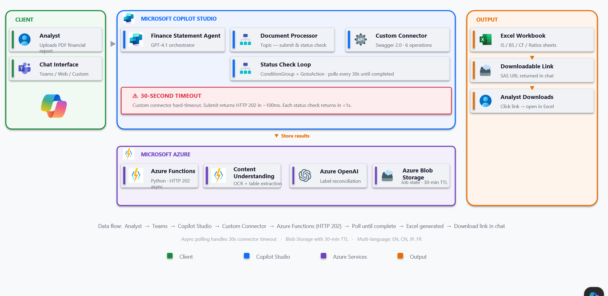

# Finance Statement Agent

Conversational AI for credit financial statement extraction. An analyst uploads a PDF financial report in Microsoft Teams; the agent returns a structured Excel workbook (Income Statement, Balance Sheet, Cash Flow, Ratios) ready for credit spreading.

> **Status:** Reference implementation · **Last verified:** 2026-04-30

---

## Capabilities

- Extracts **Income Statement, Balance Sheet, Cash Flow** and computed **Ratios** from PDF financial reports
- **Multi-language**: English, Chinese, Japanese, French (auto-detected, label-reconciled to canonical schema)
- **Conversational delivery** in Microsoft Teams via Copilot Studio
- **Async pipeline** — submits in ~100 ms, returns a downloadable Excel link when ready
- **Pluggable extraction backend** — Content Understanding (default), Document Intelligence, Textract, or local pdfplumber
- **Managed Identity only** — no API keys for Azure service-to-service auth

---

## Architecture



**Data flow:** Analyst → Teams → Copilot Studio → Custom Connector → Azure Functions (HTTP 202) → Poll until complete → Excel generated → Download link in chat

| Layer | Component | Role |
|---|---|---|
| **Client** | Microsoft Teams (or Web / custom channel) | Chat surface; analyst uploads the PDF |
| **Copilot Studio** | Finance Statement Agent (GPT-4.1) | Orchestrator; routes to topics |
|  | `DocumentProcessor` topic | Submit PDF, run polling loop, render result |
|  | Custom Connector (Swagger 2.0, 6 ops) | HTTPS bridge to Azure Functions |
| **Azure** | Azure Functions (Python 3.11) | Async pipeline; returns HTTP 202 + `jobId` |
|  | Content Understanding | OCR + table extraction |
|  | Azure OpenAI (GPT-4.1) | Label reconciliation, classification, enrichment |
|  | Azure Blob Storage | Job state (30-min TTL) + Excel artifacts |
| **Output** | Excel workbook (IS / BS / CF / Ratios) | Returned as time-limited SAS URL in chat |

### Async extraction & polling

Power Platform custom connectors have a **default 30-second synchronous request timeout**. PDF extraction can take 30 s – 5 min depending on document size and backend, so the pipeline uses an **async job + polling** pattern — every connector call returns well under 30 s.

```
CPS Agent              Custom Connector          Azure Function
  │  POST /extract  ──────►  forward  ──────►  start background job
  │                                            persist {status:"processing"} to blob
  │  ◄── 202 {jobId, status:"processing"}                       (~100 ms)
  │
  │  (poll every 30 s, bounded by max-attempts)
  │  GET /extract/status/{jobId}  ──────────►  read job blob
  │  ◄── 200 {status:"processing"}                              (<1 s)
  │  ...
  │  ◄── 200 {status:"completed", result:{...}}
  ▼
Render summary card + Excel SAS link
```

**Backend contract** (`azure-functions/extractor/extract_endpoints.py`):
- `POST /api/extract` and `/api/extract-by-url` — spawn a background thread, persist `{status:"processing"}`, return `202` with `jobId` and `Location: /api/extract/status/{jobId}` immediately
- `GET /api/extract/status/{jobId}` — anonymous; returns `{status: processing | completed | failed, result?, error?}`

**Copilot Studio side** (`copilot-studio-agent/topics/DocumentProcessorV2.mcs.yml`):
- After upload, calls extract action and stores `jobId`
- Status check loop (`ConditionGroup` + `GotoAction`) polls every 30 s
- Bounded by a max-attempts guard; timeout surfaces a user-friendly error
- On `completed`, hands off to summary card + Excel generation

**Pipeline rules:**
- `/extract` itself **must never block** — every connector call must return well under 30 s
- All long work belongs in `run_job()` (the background thread target)
- The status payload shape is a contract with the CPS polling loop — change it in both places

---

## Repository layout

```
finance-statement-agent/
├── azure-functions/         # Python backend (HTTP 202 async pipeline)
│   ├── function_app.py      # HTTP router
│   └── extractor/           # 5-stage pipeline + clients (CU, DI, Textract, pdfplumber)
├── copilot-studio-agent/    # Copilot Studio YAML (agent, topics, actions, workflows)
├── code-app/                # Power Apps Code App — React HITL review grid (Dataverse)
├── docs/
│   ├── architecture.png             # Architecture diagram (this README)
│   └── custom-connector-swagger.yml # Swagger 2.0 spec for the custom connector
└── .github/workflows/       # CI/CD: deploy-function.yml
```

---

## Prerequisites

| Tool | Version |
|---|---|
| Python | 3.11+ |
| Node.js | 18+ |
| Azure CLI | 2.50+ |
| Azure Functions Core Tools | 4.x |
| Power Platform CLI (`pac`) | latest |

**Azure**: subscription with rights to create Resource Group, Function App, Content Understanding (or Document Intelligence), Azure OpenAI with GPT-4.1, and Storage Account.
**Power Platform**: Copilot Studio license, environment with Dataverse, custom connector creation rights.

---

## Quick start

### 1. Clone and authenticate

```bash
git clone <repo-url>
cd finance-statement-agent
az login
az account set --subscription "<subscription-id>"
```

### 2. Provision Azure resources

See the `az` commands in `docs/provisioning.md` (or your IaC of choice). Required:
- Resource Group
- Content Understanding **or** Document Intelligence resource (S0)
- Azure OpenAI with a `gpt-4.1` deployment
- Storage Account (for job state + Excel blobs)
- Function App (Python 3.11, Linux, Consumption plan)

Grant the Function App's **system-assigned managed identity** these roles at the resource group scope:
- `Cognitive Services User` — for Content Understanding / Document Intelligence
- `Cognitive Services OpenAI User` — for Azure OpenAI
- `Storage Blob Data Contributor` — for the storage account

### 3. Configure the backend

```bash
cd azure-functions
cp .env.example .env
# edit .env with your endpoints (no keys — MI handles auth)
```

### 4. Run locally

```bash
cd azure-functions
pip install -r requirements.txt
func start
# http://localhost:7071/api/health
```

### 5. Deploy the Function

```bash
cd azure-functions
func azure functionapp publish <your-function-app> --python
```

### 6. Set up the custom connector

1. In Power Platform, **Custom connectors → New → Import OpenAPI file** → select `docs/custom-connector-swagger.yml`
2. Update the Host to your Function App
3. Authentication: **API key** (header `x-functions-key`) — retrieve via:
   ```bash
   az functionapp keys list --name <your-function-app> --resource-group <your-rg>
   ```
4. Create a connection using the new connector

### 7. Deploy the Copilot Studio agent

```bash
cd copilot-studio-agent
pac copilot push --environment <env-id>
```

### 8. Deploy the Code App (HITL review)

```bash
cd code-app
npm install
npm run build
pac code push
```

---

## Authentication model

| Hop | Mechanism | Notes |
|---|---|---|
| User → Teams → Copilot Studio | M365 SSO | Managed by the channel |
| Copilot Studio → Custom Connector | Connection (per user) | Power Platform connection record |
| Custom Connector → Function | **Function key** (`x-functions-key`) | Rotate via `az functionapp keys` |
| Function → Azure services | **Managed Identity** | No API keys; roles listed in step 2 |
| Code App → Dataverse | Delegated user auth | Power Platform native |

There are **no service-to-service API keys** in `.env` or app settings. `.env` is gitignored.

---

## Configuration

| Variable | Required | Description |
|---|---|---|
| `EXTRACTION_BACKEND` | no | `content_understanding` (default) · `document_intelligence` · `textract` · `pdfplumber` |
| `AZURE_CU_ENDPOINT` | yes (CU) | Content Understanding endpoint URL |
| `AZURE_DOCUMENT_INTELLIGENCE_ENDPOINT` | yes (DI) | DI resource endpoint URL |
| `AZURE_OPENAI_ENDPOINT` | yes | Azure OpenAI endpoint |
| `AZURE_OPENAI_DEPLOYMENT` | yes | e.g. `gpt-4.1` |
| `AZURE_OPENAI_API_VERSION` | yes | e.g. `2024-12-01-preview` |
| `AWS_REGION` | yes (Textract) | AWS region |
| `AWS_S3_BUCKET` | yes (Textract) | Bucket for temp PDF upload |

See `azure-functions/.env.example` for the full template.

---

## API reference

| Method | Path | Auth | Purpose |
|---|---|---|---|
| `POST` | `/api/extract` | function key | Submit PDF (multipart) — returns `202 {jobId}` |
| `POST` | `/api/extract-by-url` | function key | Submit PDF by URL — returns `202 {jobId}` |
| `GET` | `/api/extract/status/{jobId}` | anonymous | Poll job status (used by CPS loop) |
| `POST` | `/api/generate-excel` | function key | Build Excel workbook from a completed result |
| `POST` | `/api/build-review-card` | function key | Build Adaptive Card for CPS display |
| `POST` | `/api/parse-card-submission` | function key | Parse Adaptive Card submit payload |
| `GET` | `/api/fx-rate` | anonymous | Fetch FX conversion rates |
| `GET` | `/api/health` | anonymous | Health check |

Full Swagger 2.0 spec: `docs/custom-connector-swagger.yml`.

---

## Testing

```bash
# Backend
cd azure-functions && pytest

# Frontend
cd code-app && npm test
```

End-to-end smoke test: upload a sample PDF in the deployed agent, confirm the polling loop completes and the SAS link returns a valid Excel workbook.

---

## Operational notes

- **Job state TTL**: 30 minutes in Blob Storage. Polling beyond that returns `not_found`.
- **SAS URLs**: time-limited; regenerate by re-running `/generate-excel` if expired.
- **Upload size**: handled via the Copilot Studio `Question` node bound to `FilePrebuiltEntity` — direct `Activity.Attachments` access fails for files > 5 MB.
- **Multi-language**: label reconciliation runs in Stage 4 (Azure OpenAI). Adding a language requires extending the canonical-key dictionary, not retraining.

---

## License & contributing

Internal reference implementation. See `CONTRIBUTING.md` (TBD) for development workflow.
